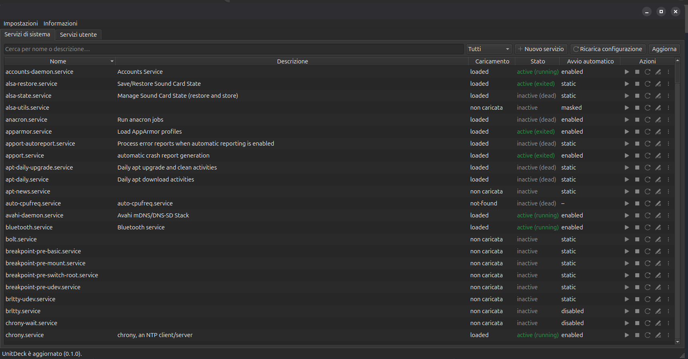

# UnitDeck

[English](README.md) | **Italiano**

[](LICENSE)
[](https://github.com/n1c0p/UnitDeck/releases)
[](https://github.com/n1c0p/UnitDeck/releases)
[](https://github.com/n1c0p/UnitDeck/actions/workflows/ci.yml)
[](https://api.reuse.software/info/github.com/n1c0p/UnitDeck)
[](https://www.python.org/)
[](https://www.riverbankcomputing.com/software/pyqt/)
[](https://systemd.io/)

**UnitDeck** è un'applicazione desktop per Linux che permette di gestire i **servizi systemd**, sia **di sistema** sia **utente**, da un'interfaccia grafica semplice e ordinata.



> **Stato: prime release (0.x).** La prima versione è pubblicata e utilizzabile; aspettati qualche spigolo e segnalalo nelle [issue](https://github.com/n1c0p/UnitDeck/issues).

## Perché UnitDeck

Gestire i servizi di solito significa destreggiarsi tra `systemctl`, `systemctl --user`, `journalctl` e un editor aperto con `sudo`. UnitDeck riunisce tutto in un'unica finestra, senza mai eseguire l'interfaccia come root.

## Funzionalità

- **Due schede:** servizi di sistema e servizi utente, ciascuna con una tabella ricercabile e filtrabile che mostra stato di caricamento, stato di esecuzione e avvio automatico.
- **Azioni rapide su ogni riga:** avvia, ferma, riavvia, modifica, più ricarica, abilita/disabilita all'avvio, log, maschera/smaschera, ripristina originale ed elimina.
- **Modifica sicura con i drop-in:** per i servizi installati dai pacchetti, le modifiche vengono salvate come drop-in `override.conf` (come fa `systemctl edit`), così sopravvivono agli aggiornamenti. L'azione "Ripristina originale" le annulla. Ogni modifica viene validata con `systemd-analyze verify` prima del salvataggio.
- **Creazione guidata di nuovi servizi:** crea servizi di sistema o utente partendo da template, con validazione e l'opzione "abilita e avvia subito".
- **Log in tempo reale:** l'output del journal per il servizio selezionato, con aggiornamento live e filtro per priorità.
- **Stato sempre aggiornato:** gli aggiornamenti arrivano direttamente da systemd via D-Bus, senza polling.
- **Interruttore per il linger:** permette ai servizi utente di funzionare anche senza login grafico.

## Modello di sicurezza

UnitDeck è progettato per **non girare mai come root** e si rifiuta di partire se viene avviato con privilegi di root.

- I **servizi utente** sono gestiti tramite il bus di sessione: non viene mai chiesta nessuna password.
- I **servizi di sistema** sono gestiti tramite il bus di sistema con l'autorizzazione interattiva di polkit: la finestra di autenticazione nativa del desktop compare **solo** quando esegui un'azione privilegiata (avvio, arresto, modifica, …). Consultare servizi, stato e log non richiede mai la password.
- La **scrittura dei file di sistema** passa da un piccolo helper verificabile, avviato tramite `pkexec`, che accetta solo un insieme fisso di operazioni e solo percorsi sotto `/etc/systemd/system`. La sua action polkit usa `auth_admin_keep`, così il salvataggio di un file e il `daemon-reload` successivo chiedono la password una volta sola; per farsela chiedere ogni volta, sostituisci `auth_admin_keep` con `auth_admin` in `/usr/share/polkit-1/actions/eu.nicop.unitdeck.policy`.
- UnitDeck non legge, non salva e non gestisce mai la tua password: l'autenticazione è interamente delegata a polkit.

## Requisiti

- Una distribuzione Linux con **systemd** e **polkit** (obiettivo principale: versioni recenti di Ubuntu con GNOME, su X11 o Wayland). Il pacchetto `.deb` è compilato su **Ubuntu 24.04 LTS**, la versione più vecchia supportata.
- Un agente di autenticazione polkit (incluso in tutti i principali ambienti desktop).

## Installazione

Scarica il pacchetto `.deb` dalla [pagina Releases](https://github.com/n1c0p/UnitDeck/releases) e installalo:

```bash
sudo apt install ./unitdeck_<versione>_amd64.deb
```

### Compilare e installare dai sorgenti

UnitDeck è scritto in **Python 3.12+** con **PyQt6**. Due strade, entrambe a partire da un clone:

```bash
git clone https://github.com/n1c0p/UnitDeck.git
cd UnitDeck
```

**Pacchetto compilato in locale (consigliato).** Stesso risultato del pacchetto pubblicato, rimovibile con il gestore dei pacchetti. Compila su Ubuntu 24.04 o successiva:

```bash
sudo apt install git python3 python3-venv libpython3.12 binutils lintian
python3 -m venv .venv
.venv/bin/pip install . pyinstaller
PYTHON=.venv/bin/python packaging/build-deb.sh
sudo apt install ./dist/unitdeck_*.deb
```

`packaging/build-deb.sh` impacchetta l'applicazione con PyInstaller (`unitdeck.spec`, modalità onedir) in `/opt/unitdeck`, aggiunge helper, policy polkit, file desktop, icona e pagina man, e produce il `.deb` con `dpkg-deb`, controllato da `lintian` (i pochi tag accettati per scelta sono in `packaging/lintian-suppress`). `packaging/test-install.sh` installa il risultato in un container Ubuntu 24.04 pulito ed esegue `unitdeck --check`. Si disinstalla con `sudo apt remove unitdeck`.

**Manuale, senza PyInstaller.** Un ambiente virtuale esegue l'applicazione; helper e policy polkit, necessari solo per modificare i file unit di sistema, si installano una volta con uno script:

```bash
python3 -m venv .venv
.venv/bin/pip install .
packaging/install-dev-helper.sh      # chiede sudo; "uninstall" li rimuove
.venv/bin/unitdeck
```

Per una voce nel menu delle applicazioni, crea `~/.local/share/applications/eu.nicop.unitdeck.desktop` partendo da `packaging/eu.nicop.unitdeck.desktop` con `Exec=` che punta a `.venv/bin/unitdeck` e `Icon=` a `packaging/icons/eu.nicop.unitdeck.svg` (percorsi assoluti). Il numero di versione deriva dai tag git tramite `setuptools-scm`: un checkout tra una release e l'altra riporta una versione di sviluppo.

In entrambi i casi la macchina ha bisogno di systemd, polkit con un agente di autenticazione del desktop, `pkexec`, `systemd-analyze` e `journalctl`, tutti presenti su un desktop Ubuntu standard. Ogni push su `develop` compila un pacchetto di anteprima, conservato 14 giorni come artifact del workflow; ogni merge su `main` pubblica una release (vedi CONTRIBUTING).

## Uso

Le tab **Servizi di sistema** e **Servizi utente** elencano tutte le unit `.service` del manager di sistema e della sessione utente, comprese quelle installate ma non caricate. Elenco, stati e log non chiedono mai la password; la prima azione privilegiata su un servizio di sistema (avvio, arresto, abilitazione, …) apre il dialogo polkit del desktop, e annullarlo lascia il servizio com'era. Ogni riga ha i pulsanti avvia, ferma e riavvia più un menu "⋯" con ricarica, abilita/disabilita all'avvio, maschera/smaschera e log. Le stesse azioni sono disponibili dal menu del tasto destro e, sulla riga selezionata, da tastiera:

| Scorciatoia | Azione |
|-------------|--------|
| `Ctrl+S` | Avvia |
| `Ctrl+T` | Ferma |
| `Ctrl+R` | Riavvia |
| `Ctrl+L` | Mostra log (anche doppio clic) |

### Modificare un servizio

*Modifica* (`Ctrl+E`) apre un editor con evidenziazione sintattica e numeri di riga accanto alla configurazione effettiva (file unit più tutti i drop-in, con i rispettivi percorsi). Per una unit fornita da un pacchetto l'editor scrive un drop-in `override.conf` in `/etc/systemd/system/<unit>.d/` (o `~/.config/systemd/user/<unit>.d/` per i servizi utente): lì vanno solo le direttive che cambi, e gli aggiornamenti del pacchetto continuano a funzionare. Una casella permette invece di creare una copia completa della unit, che nasconde il file del pacchetto. Le unit create da te si modificano direttamente. Prima del salvataggio il file viene controllato con `systemd-analyze verify` e gli avvisi vengono mostrati; il file precedente resta come `.bak`; dopo il salvataggio UnitDeck esegue `daemon-reload` e propone di riavviare il servizio. *Ripristina originale* rimuove drop-in e copie locali di una unit di pacchetto (come `systemctl revert`), *Elimina* ferma, disabilita e rimuove una unit creata da te.

### Creare un servizio

*Nuovo servizio* apre un wizard in quattro passi: nome e template, campi guidati (descrizione, comando, tipo, politica di riavvio, dipendenze e, per i servizi di sistema, gli opzionali `User=`/`Group=`, senza i quali il servizio gira come root), un'anteprima modificabile controllata con `systemd-analyze verify`, e le opzioni finali "abilita all'avvio" / "avvia subito". La unit viene scritta in `~/.config/systemd/user/` dalla tab utente o in `/etc/systemd/system/` dalla tab di sistema (tramite l'helper, quindi polkit chiede la password). I nomi già usati da una unit in qualunque percorso di ricerca di systemd vengono rifiutati.

I template sono semplici file in `src/unitdeck/templates/`: un servizio vuoto, un'attività oneshot con `RemainAfterExit`, un servizio long-running con `Restart=on-failure` e, solo per i servizi utente, una condivisione SMB montata con `gio` (richiede una sessione utente con D-Bus). Aggiungerne uno è una piccola pull request, vedi CONTRIBUTING.

### Linger

La tab utente ha un interruttore *Linger*: quando è attivo, i tuoi servizi utente restano in esecuzione anche senza una sessione aperta (quello che fa `loginctl enable-linger`). Il cambio passa da logind e chiede l'autorizzazione.

I log di sistema sono leggibili senza password solo se il tuo utente appartiene al gruppo `adm` o `systemd-journal` (impostazione predefinita per il primo utente su Ubuntu); altrimenti la finestra dei log mostra il suggerimento di journalctl.

La tabella segue i segnali D-Bus di systemd, quindi gli stati si aggiornano da soli. "Ricarica configurazione" esegue un `daemon-reload` dopo che hai modificato i file unit su disco.

L'interfaccia è disponibile in inglese e in italiano: segue la lingua del desktop per impostazione predefinita e si cambia da *Impostazioni → Lingua*.

### Aggiornamenti

All'avvio UnitDeck chiede all'API delle GitHub Releases (`api.github.com`) se esiste una versione più recente; non viene inviato nient'altro. Si disattiva da *Impostazioni → Controlla aggiornamenti all'avvio*, oppure si controlla a mano da *Informazioni → Controlla aggiornamenti…*. Quando c'è un aggiornamento puoi leggere le note di rilascio, scaricare il `.deb` (il suo SHA256 viene verificato con il checksum pubblicato nella release) e installarlo: l'installazione esegue `apt-get` tramite `pkexec`, quindi il desktop chiede la password. Il controllo è saltato quando si esegue una versione di sviluppo dai sorgenti.

## Dipendenze e licenze

Tutte le dipendenze sono compatibili con la licenza GPL-3.0-or-later del progetto.

| Pacchetto | Ruolo | Licenza |
|-----------|-------|---------|
| [PyQt6](https://www.riverbankcomputing.com/software/pyqt/) | Toolkit grafico e binding D-Bus (QtDBus) | GPL-3.0-only |
| [setuptools-scm](https://github.com/pypa/setuptools-scm) | Versione dai tag git (solo in fase di build) | MIT |
| [pytest](https://pytest.org/) | Test (solo sviluppo) | MIT |
| [ruff](https://docs.astral.sh/ruff/) | Lint e formattazione (solo sviluppo) | MIT |
| [reuse](https://reuse.software/) | Controllo di conformità delle licenze (solo sviluppo) | Apache-2.0 / GPL-3.0-or-later |
| [PyInstaller](https://pyinstaller.org/) | Impacchetta l'applicazione per il `.deb` (solo build) | GPL-2.0-or-later con eccezione per il bootloader |

## Contribuire

I contributi sono benvenuti. Il repository usa due branch permanenti:

- `main`: corrisponde sempre all'ultima release;
- `develop`: sviluppo in corso, destinazione di tutte le pull request.

Parti da `develop` creando un branch `feature/*` o `fix/*` e apri una pull request verso `develop`. [CONTRIBUTING.it.md](CONTRIBUTING.it.md) descrive il flusso completo: branch, pull request, intestazioni SPDX, come si prepara una release e quali ruleset GitHub proteggono `main`, `develop` e i tag `v*`.

Leggi [CODE_OF_CONDUCT.md](CODE_OF_CONDUCT.md); i problemi di sicurezza passano da [SECURITY.it.md](SECURITY.it.md), non da issue pubbliche.

La documentazione è mantenuta in inglese e in italiano: quando modifichi `README.md` o `CHANGELOG.md`, aggiorna anche `README.it.md` e `CHANGELOG.it.md`. Se non ti trovi a tuo agio con una delle due lingue, segnalalo nella pull request e la traduzione verrà completata dal maintainer.

Le release sono automatiche: una pull request da `develop` a `main` imposta la versione in entrambi i changelog e, al merge, il commit viene taggato, il `.deb` compilato e la GitHub Release pubblicata.

I template dei servizi sono semplici file nel repository: aggiungerne uno nuovo con una pull request è un ottimo primo contributo.

## Changelog

Tutte le modifiche rilevanti sono elencate in [CHANGELOG.it.md](CHANGELOG.it.md).

## Licenza

Copyright (C) 2026 Nicola Palmieri ([n1c0p](https://github.com/n1c0p))

UnitDeck è software libero: puoi redistribuirlo e/o modificarlo secondo i termini della GNU General Public License, pubblicata dalla Free Software Foundation, nella versione 3 della licenza o (a tua scelta) in una qualsiasi versione successiva.

UnitDeck è distribuito nella speranza che sia utile, ma SENZA ALCUNA GARANZIA, nemmeno la garanzia implicita di COMMERCIABILITÀ o di IDONEITÀ PER UNO SCOPO PARTICOLARE. Per i dettagli consulta la [GNU General Public License](LICENSE). Il testo della licenza in `LICENSE` è quello ufficiale in inglese, l'unico con valore legale.
